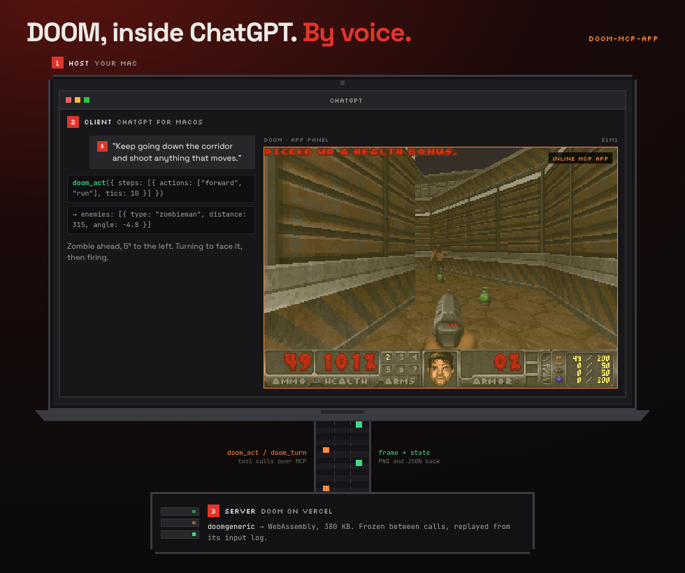
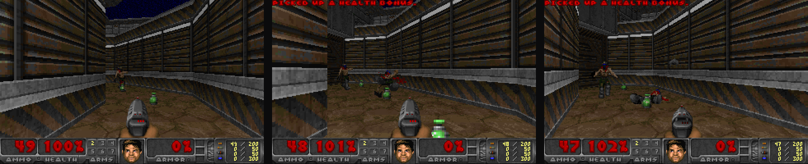
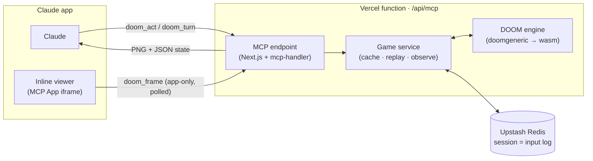

<h1 align="center">DOOM, inside ChatGPT. By voice.</h1>

<p align="center">
  <br>
  <sub><i>Your Mac runs ChatGPT. ChatGPT shows the game in an app panel. DOOM itself runs on a server on Vercel, one tool call at a time.</i></sub>
</p>

<p align="center">
  <a href="https://doom-mcp.vercel.app"><b>Landing page</b></a> &middot;
  <a href="#install"><b>Add it to ChatGPT or Claude</b></a> &middot;
  <a href="https://claude.ai/artifact/F5uGrMYXP7UnsTLz2EJsm1">Architecture explainer</a>
</p>

An experiment in how far **MCP Apps** can go. DOOM runs headless on a server as WebAssembly, exposed as a remote [MCP](https://modelcontextprotocol.io) server with an inline [MCP App](https://modelcontextprotocol.io/extensions/apps/overview) viewer. The model sees the game (a screenshot, structured state, or both) and plays it through tool calls. The game is frozen between calls, so the model can take as long as it likes to think.

The goal: play it inside ChatGPT, by voice.

- **Autonomous:** "Start a game of DOOM and clear E1M1."
- **Directed:** "Go through the door on the left and kill the imp."
- **Voice:** say it out loud in ChatGPT and let the model turn it into game actions *(in progress)*.
- **Human:** play it yourself in the browser *(in progress)*.

**Live MCP endpoint:** `https://doom-player.vercel.app/api/mcp`, see [Install](#install).

> **Status:** the engine and the MCP server work and are live. Playing inside ChatGPT, and by voice, is what we're building and testing now. The image above is a mock-up around a real frame from the engine.

---

## Contents

- [Install](#install)
- [What the model sees](#what-the-model-sees)
- [How it works](#how-it-works)
- [Run it locally](#run-it-locally)
- [Connect your local server to Claude](#connect-your-local-server-to-claude)
- [The tools](#the-tools)
- [Development](#development)
- [Deploying](#deploying)
- [Project layout](#project-layout)
- [License](#license)

---

## Install

It's a normal remote MCP server: add it to your client by URL. No sign-in needed.

```
https://doom-player.vercel.app/api/mcp
```

Transport: Streamable HTTP (not SSE).

**ChatGPT**

1. Open ChatGPT Plugins (chatgpt.com/plugins), select **+**, then **Add custom MCP server**.
2. Give it a name (e.g. DOOM) and paste the URL above under **Connection**.
3. Leave authentication off, confirm the warning, and select **Create as a plugin**.
4. Start a new chat, type `@`, pick DOOM and ask: "Start a game of DOOM and play E1M1. Caption each move."

Adding custom MCP servers depends on your ChatGPT plan and workspace settings.

**Claude** (web or desktop)

1. Open **Settings → Connectors → Add custom connector**.
2. Paste the URL above and save.
3. In a new chat, ask: "Start a game of DOOM and play E1M1. Caption each move."

**Claude Code**

```bash
claude mcp add --transport http doom https://doom-player.vercel.app/api/mcp
```

**Any other MCP client** that supports Streamable HTTP works the same way. To poke at the tools directly, run `npx @modelcontextprotocol/inspector@latest` and point it at the URL.

---

## What the model sees

<p align="center">
  <br>
  <sub><i>Spot, turn, fire. Three real frames from a headless run.</i></sub>
</p>

Real frames from the engine in this repo (Freedoom E1M1). The state says a zombie is 315 units away, 4.8° to the left. One `doom_turn` by exactly that angle and a `doom_act` fire later, it's down, and the next one walks in.

---

## How it works



Four ideas make it work:

| Idea | What it means |
|---|---|
| **Virtual time** | The engine's clock only moves when Claude acts. Each call advances an exact number of tics (35 tics = 1 s), then the game freezes. |
| **Deterministic replay** | Serverless functions don't keep a game in memory. A session is just the list of inputs, stored in Redis; any instance rebuilds the exact game by replaying it (~14 ms for 5 minutes of play). A warm cache skips replay most of the time. |
| **Exact controls** | Inputs go straight into DOOM's per-tic command (`ticcmd`) through a 3-line patch, so "turn 37.5° right" is exact. That makes aiming at enemies by their relative angle work. |
| **Perception modes** | Each action returns a 640×400 screenshot (`vision`), structured state such as enemies with distance, angle and `in_crosshair` (`state`), or both (`both`, the default). |

There's an interactive walkthrough of one action, end to end, in the [architecture explainer](https://claude.ai/artifact/F5uGrMYXP7UnsTLz2EJsm1).

---

## Run it locally

### Requirements

| Tool | Version | Needed for |
|---|---|---|
| Node.js | 24+ (`.nvmrc`) | everything |
| pnpm | 12 (via `packageManager`; `corepack enable` works) | everything |
| curl, unzip (or python3) | any | downloading the Freedoom WAD |
| Emscripten | 7.0.0 (`engine/emsdk-version.txt`) | **only** if you change the C engine |

You don't need Emscripten to run the project: the compiled engine (`engine/dist/`) is committed.

### 1. Install and fetch the game data

```bash
git clone --recursive https://github.com/ionut85/doom-mcp-app.git
cd doom-mcp-app
pnpm install
pnpm get-wad
```

`pnpm get-wad` downloads [Freedoom](https://freedoom.github.io) Phase 1 (free, BSD-licensed) to `wads/freedoom1.wad` and verifies its checksum. To use your own IWAD instead, set `DOOM_IWAD=/path/to/doom.wad`.

### 2. Check the engine works

```bash
pnpm test
pnpm play-cli
```

- `pnpm test` runs determinism, replay and game-service tests.
- `pnpm play-cli` plays a short scripted run of E1M1 and writes frames to `out/*.png`.

### 3. Start the MCP server

```bash
pnpm dev
```

This builds the inline viewer and starts Next.js on http://localhost:3000. The MCP endpoint is http://localhost:3000/api/mcp.

Redis is optional locally: without it, sessions are kept in memory (lost on restart). To use Redis, put these in `apps/web/.env.local`, or run `vercel env pull apps/web/.env.local` if you have access to the Vercel project:

```
KV_REST_API_URL=...
KV_REST_API_TOKEN=...
```

### 4. Watch a bot play

In a second terminal, while `pnpm dev` is running:

```bash
pnpm bot
```

`scripts/mcp-bot.ts` is a simple scripted player (no AI). It plays 40 actions through the real MCP tools and prints health, kills, events and latency. Arguments: `pnpm bot [url] [actions] [vision|state|both]`.

---

## Connect your local server to Claude

**Claude Code** can reach localhost directly:

```bash
claude mcp add --transport http doom-local http://localhost:3000/api/mcp
```

**claude.ai** needs a public URL. Either deploy (see [Deploying](#deploying)) or tunnel your dev server, for example with `cloudflared tunnel --url http://localhost:3000`. Then add `<tunnel-url>/api/mcp` as a custom connector.

---

## The tools

| Tool | Who calls it | What it does |
|---|---|---|
| `doom_new_game` | Claude | Starts a game: `skill` 1–5 (default 3), `episode`, `map`, and `perception` (`vision` \| `state` \| `both`). Shows the inline viewer and returns a `session_id`. |
| `doom_act` | Claude | Holds actions for a number of tics, up to 8 steps and 105 tics per call. Actions: `forward`, `back`, `strafe_left`, `strafe_right`, `turn_left`, `turn_right`, `run`, `fire`, `use`, `weapon_1`…`weapon_7`. Takes an optional `caption` shown in the viewer. |
| `doom_turn` | Claude | Turns by exact degrees: negative = left, positive = right, the same convention as enemy angles. |
| `doom_observe` | Claude | Returns the current observation without advancing time. |
| `doom_frame` | Viewer only | Returns the latest frame, HUD and captions for the inline viewer. Hidden from Claude via `visibility: ["app"]`. |

An observation in `state` or `both` mode looks like this, shortened:

```json
{
  "status": "alive", "health": 87, "armor": 0, "weapon": "pistol", "ammo": 42, "kills": "3/29",
  "enemies": [{ "type": "imp", "distance": 412, "angle": -12.5, "on_screen": true, "in_crosshair": false, "health": 60 }],
  "nearby_items": [{ "type": "stimpack", "distance": 289, "angle": -59.6 }],
  "events": ["took 8 damage from 30° left", "killed 1 enemy", "moved 96 units"],
  "hint": "Nearest enemy is 12° left; doom_turn by its angle to aim."
}
```

Limits per session: 30,000 tics (about 14 minutes of game time), a 24 h lifetime, and 300 requests per minute per IP.

---

## Development

| Command | What it does |
|---|---|
| `pnpm test` | All tests (Vitest) |
| `pnpm bench` | Replay speed benchmark (1k / 5k / 10k tics) |
| `pnpm typecheck` | Typecheck `doom-core` and scripts (`pnpm --dir apps/web typecheck` for the app) |
| `pnpm play-cli [script.json]` | Run a scripted step list headlessly and write PNGs to `out/` |
| `pnpm dev` | Run the web app and MCP server locally |
| `pnpm bot [url] [n] [mode]` | Scripted bot against an MCP endpoint |
| `pnpm build:engine` | Rebuild `engine/dist/` from C (needs Emscripten) |

### Changing the C engine

Install [emsdk](https://emscripten.org/docs/getting_started/downloads.html) at the pinned version, then rebuild:

```bash
source ~/emsdk/emsdk_env.sh
pnpm build:engine
pnpm test
```

Commit the updated `engine/dist/` with your change. CI rebuilds the engine and fails if the committed output is stale.

- Never edit `engine/doomgeneric/` (a git submodule). Changes to upstream code go in `engine/patches/*.patch`; our own C lives in `engine/dg_headless.c` and `engine/dg_exports.c`.
- The state and object layouts in `dg_exports.c` are mirrored in `packages/doom-core/src/core.ts`. Change both together.
- Determinism is a hard requirement: no wall clock and no randomness in anything that feeds the engine.

Useful environment variables:

| Variable | Effect |
|---|---|
| `DOOM_IWAD` | Path to a different IWAD |
| `DOOM_ENGINE_CACHE` | Max warm engines per server instance (default 6; `0` forces replay on every call) |
| `KV_REST_API_URL`, `KV_REST_API_TOKEN` | Upstash Redis for sessions and rate limiting |

---

## Deploying

The app deploys to [Vercel](https://vercel.com) as a Next.js project:

- **Root directory:** `apps/web`
- **Node.js:** 24.x, with Fluid compute on
- **Environment variables:**
  - `ENABLE_EXPERIMENTAL_COREPACK=1`, so Vercel uses the pinned pnpm 12;
  - `KV_REST_API_URL` and `KV_REST_API_TOKEN`, which the Upstash for Redis Marketplace integration adds automatically.
- **Build command:** the default `pnpm build`. It downloads Freedoom, builds the viewer, then runs `next build`.

```bash
vercel link
vercel integration add upstash/upstash-kv
vercel deploy --prod
```

---

## Project layout

```
engine/                  C engine → WebAssembly (Emscripten)
  doomgeneric/           upstream portable DOOM (git submodule, never edited)
  patches/               ticcmd injection hook (3 lines)
  dg_headless.c          virtual clock, framebuffer, key queue
  dg_exports.c           JS API: boot, step, render, player state, nearby objects
  dist/                  committed build output (doom.mjs + doom.wasm)
packages/doom-core/      TypeScript engine wrapper (Node + browser) and tests
apps/web/                Next.js app on Vercel
  app/api/mcp/           MCP endpoint and tools
  lib/                   sessions (Redis), engine cache and replay, observations
  ui/viewer/             inline MCP App viewer (single-file Vite build)
scripts/                 get-wad.sh, play-cli.ts, mcp-bot.ts
docs/PLAN.md             plan, progress, deviations and measurements
```

---

## License

GPL-2.0 (see [LICENSE](LICENSE) and [NOTICE](NOTICE)). Built on [doomgeneric](https://github.com/ozkl/doomgeneric) (GPL-2.0) and [Freedoom](https://freedoom.github.io) (BSD-3-Clause). DOOM is a trademark of id Software; this project is not affiliated with or endorsed by id Software, ZeniMax or Bethesda. No id Software WAD files are included.
